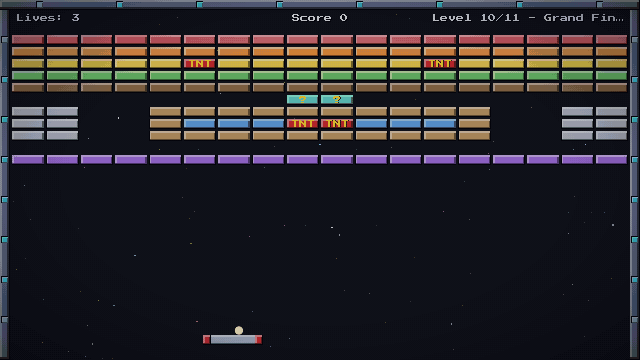
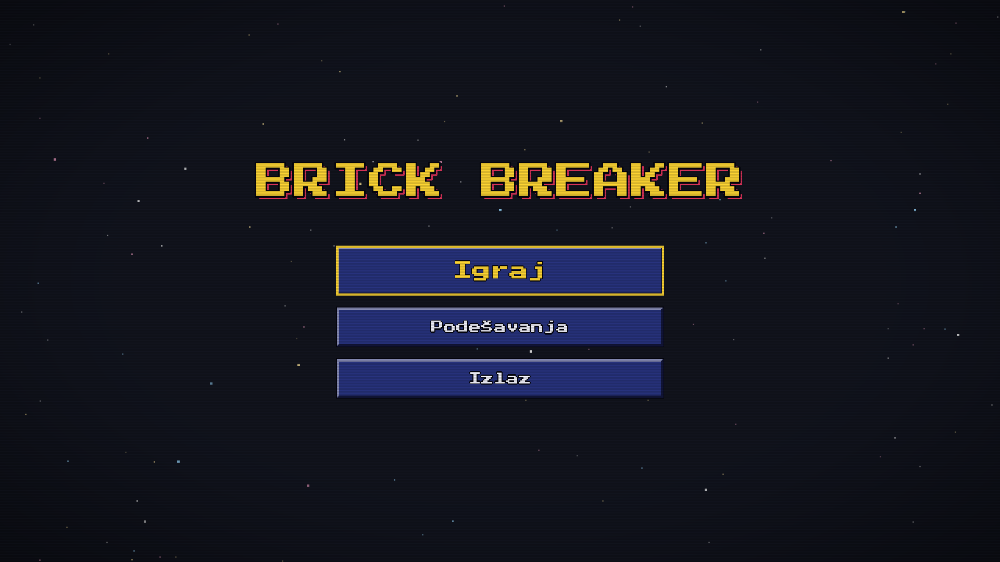
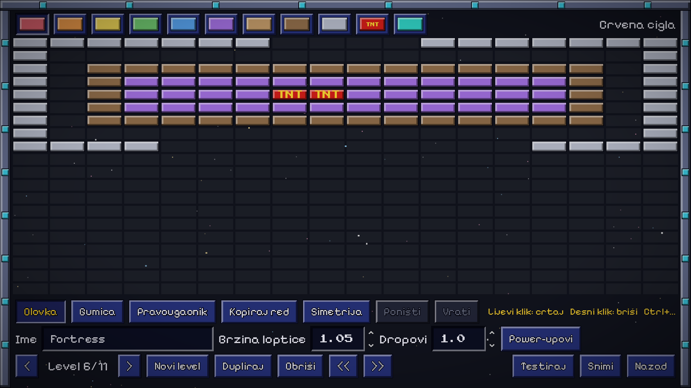
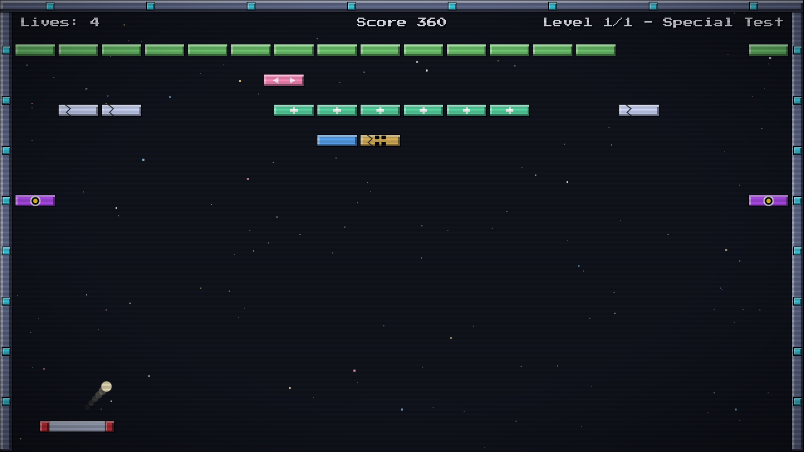
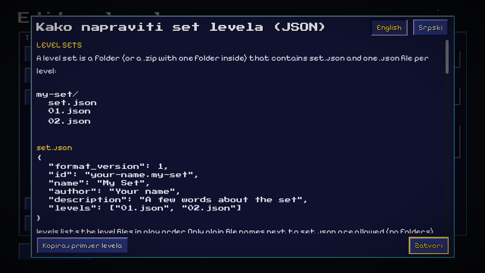

<div align="center">

# 🧱 Brick Breaker




</div>

---

## 📌 Project Overview

**Brick Breaker** is a DX-Ball 2 / Arkanoid style arcade game with a retro look: pixel fonts, a CRT
filter, chiptune music and plenty of screen shake. It stands on three pillars: **many levels**,
**many power-ups**, and an **in-game level editor** with level sets you can share.

Everything you see is drawn in code. Bricks, capsules, icons, the starfield and the arena frame are
all canvas primitives, and the UI theme is generated by a script. Music and most sound effects
are generated too. Content is data-driven: a new brick type, power-up or level is a data file,
plus at most one small script.

---

## ✨ Features

- 🎯 **Hand-rolled ball physics.** Built on `CharacterBody2D` + `move_and_collide()`. The bounce
  angle depends on where the ball hits the paddle (up to ~65°), a minimum vertical angle is
  enforced, and the ball moves in substeps at high speed so it never tunnels through bricks.
- 💊 **19 power-ups, good and bad.** Multiball, fire ball, sticky paddle, slow motion, points ×2,
  lightning, mega ball and more, plus traps like death, fortify and small ball. They arrive as
  round spinning capsules with code-drawn icons.
- 🧱 **11 kinds of bricks** (16 types counting the colours of normal bricks). There are 2- and
  3-hit, steel, TNT with chain explosions, bonus, ghost, moving, regenerating, portal and
  spawner bricks.
- 🔥 **Combo scoring.** The multiplier grows every 3 bricks broken before the ball returns to the
  paddle, up to ×5, and every 50,000 points earns an extra life.
- 🛠️ **Level editor.** Pencil, eraser, rectangle, row copy and mirror tools, undo/redo,
  per-level settings and a one-click **Test** mode.
- 📦 **Level sets.** Create sets, export and import them as `.zip` or single JSON levels, then
  play imported sets straight from the menu.
- 📖 **Built-in format guide.** An info screen explains the level JSON format, in English and
  Serbian.
- 🔓 **Progress.** You start from level 1, and every level you clear becomes a possible starting
  point. High scores are saved locally.
- 🌍 **English and Serbian UI.** Switch the language in settings; every string is a translation
  key.
- 🎵 **Audio.** 9 chiptune tracks on a level playlist, generated retro SFX and Kenney CC0 sounds,
  with separate music and SFX volume and on/off switches.
- 💥 **Juice.** Particle bursts, screen shake, hit stop on explosions, floating score text,
  brick flashes and ball trails.
- ⏸️ **Auto-pause.** The game pauses when the window loses focus.

---

## 🎮 Controls

All input goes through Godot's Input Map, so keyboard, mouse and gamepad all work.

| Action | Keyboard | Mouse | Gamepad |
|--------|----------|-------|---------|
| Move paddle | `←` `→` / `A` `D` | Move the mouse | D-pad |
| Launch ball / release sticky ball | `Space` | Left click | `A` / `B` |
| Pause | `Esc` / `P` | | `Start` |

Touch controls for mobile are planned.

---

## 💊 Power-ups

| | Power-up | Effect |
|-|----------|--------|
| ✅ | Multiball | Every ball splits into three |
| ✅ | Mega ball | Fills the arena up to 8 balls |
| ✅ | Long paddle | Wider paddle |
| ✅ | Slow ball | Balls fly slower |
| ✅ | Sticky paddle | Balls stick to the paddle until you launch them |
| ✅ | Fire ball | Balls burn through bricks, steel included |
| ✅ | Big ball | Bigger balls |
| ✅ | Slow motion | The whole game runs at half speed for a moment |
| ✅ | Points ×2 | Double points; two of them stack to ×4 |
| ✅ | Combo lock | Hitting the paddle does not reset the combo |
| ✅ | Weaken | Every brick with 2+ hits left loses one |
| ✅ | Lightning | Lightning destroys 6 random bricks |
| ✅ | Extra life | +1 life |
| ✅ | Skip level | Clears the level at once (rare) |
| ❌ | Short paddle | Narrower paddle |
| ❌ | Fast ball | Balls fly faster |
| ❌ | Small ball | Tiny balls |
| ❌ | Fortify | Every breakable brick gets +1 hit |
| ❌ | Death | You lose a life at once (rare) |

Every power-up has a **stack rule**: refresh the timer, stack another copy, replace others in
the same group (long and short paddle cancel each other), or apply instantly. Bad power-ups
always have a lower total drop weight than good ones.

---

## 🧱 Bricks

| Brick | Hits | Behaviour |
|-------|------|-----------|
| Normal | 1 | Six colour variants |
| Hard | 2 / 3 | Shows cracks as it takes damage |
| Steel | ∞ | Indestructible, not needed to clear the level (fire ball melts it) |
| TNT | 1 | Explodes and destroys its neighbours; explosions chain |
| Bonus | 1 | Always drops a good power-up |
| Ghost | 2 | Invisible until the first hit |
| Moving | 1 | Slides left and right through free cells |
| Regen | 2 | Heals itself if you leave it alone for a few seconds |
| Portal | ∞ | Teleports the ball to its partner portal |
| Spawner | 3 | Grows new bricks into empty cells around it |

---

## 🗺️ Level format

Levels are plain JSON. Each row of the grid is a string, and a legend maps characters to brick
types, so a level is easy to write by hand as well as in the editor.

```json
{
  "format_version": 1,
  "name": "Fuse",
  "author": "Pero",
  "columns": 18,
  "legend": { ".": null, "b": "normal", "g": "normal_green", "T": "tnt", "B": "bonus" },
  "grid": [
    "..................",
    "bbbTbbbbbbbbbbTbbb",
    "ggggBgggTgggBggggg"
  ],
  "settings": { "ball_speed": 1.0, "drop_modifier": 1.0, "allowed_powerups": "all",
                "banned_powerups": [] }
}
```

A **level set** is a folder (or `.zip`) with a `set.json` manifest that lists its levels.
Built-in sets live in `res://levels/`, and your sets are saved in `user://levelsets/`. Broken
JSON or unknown brick IDs never crash the game: the level is skipped and you get a message
that says why.

---

## 🖼️ Screenshots

| Main menu | Level editor |
|-----------|--------------|
|  |  |
| **Special bricks** | **Format guide** |
|  |  |

---

## ⚙️ How it works

### Architecture principles

| Principle | Why it matters |
|-----------|----------------|
| **Data-driven content** | Brick types are `BrickType` resources, power-ups are `PowerUpDef` resources plus one `PowerUpEffect` script, and levels are JSON. Adding content never touches existing systems |
| **Systems talk through `EventBus`** | A brick only announces that it was destroyed. Scoring, drops, audio and effects each react on their own, so the juice layer can be removed without touching gameplay |
| **One owner per file type** | Only `LevelLoader` reads and writes level files (used by both the game and the editor), and only `SaveManager` writes progress |
| **Effects go through `GameContext`** | Power-up effects never reach into the game scene directly, so tests can hand them a fake context |

### Autoloads

| Autoload | Role |
|----------|------|
| `EventBus` | Global signals: `brick_destroyed`, `ball_lost`, `powerup_collected`, `explosion`... |
| `LevelLoader` | Brick catalog, level and set parsing, validation, import and export |
| `SaveManager` | `user://save.json`: settings, unlocked levels, high scores |
| `GameSession` | What to play next: a set and level, or a level under test from the editor |
| `AudioManager` | SFX pool, music playlist with fades, automatic UI sounds |
| `CrtOverlay` | Optional CRT scanline shader over everything |

---

## 🧪 Tests

The tests use [GUT](https://github.com/bitwes/Gut) (Godot Unit Test): **171 tests** across 16
scripts, written for the pure logic.

| Area | What it covers |
|------|----------------|
| Ball math | Paddle bounce angles, minimum vertical angle |
| Levels | JSON parsing and validation, serializer round trip, set manifests, import/export, every built-in level loads |
| Scoring | Combo steps, combo cap, extra lives, power-up multiplier |
| Power-ups | Stack rules, drop selection, catalog completeness (icon + translation for each), effects against a fake game |
| Bricks | Grid helpers, TNT chain reactions, ghost / regen / moving / portal / spawner behaviour |
| Save data | Defaults, unlocks, high scores, broken save files |

```powershell
godot --headless --path . -s addons/gut/gut_cmdln.gd -gdir=res://tests -gexit
```

Gameplay is also checked with headless simulations: a harness script plays real levels with
`--fixed-fps 60`, so minutes of game time run in seconds.

---

## 📁 Project structure

```
brick-breaker/
├── project.godot
├── autoload/          # EventBus, LevelLoader, SaveManager, GameSession, AudioManager
├── scenes/
│   ├── menu/          # Main menu, settings, set and level select
│   ├── game/          # Game, Paddle, Ball, Brick, PowerUpDrop, HUD, effects, pause
│   └── editor/        # Editor hub, level editor, format help
├── scripts/
│   ├── bricks/        # BrickType, BrickGrid, one behaviour script per special brick
│   ├── levels/        # LevelData, parser, serializer
│   ├── powerups/      # PowerUpDef, rules, drop selector, icons, effects/ (one per power-up)
│   ├── save/          # Save data model
│   ├── scoring/       # ScoreTracker
│   └── ui/            # Retro drawing and text helpers
├── data/
│   ├── bricks/        # BrickType .tres files
│   └── powerups/      # PowerUpDef .tres files
├── levels/classic/    # Built-in level set (JSON)
├── i18n/              # strings.csv (EN / SR) and help texts
├── ui/                # Generated retro theme
├── assets/            # Fonts, sounds, music
├── tests/             # GUT tests and fixtures
└── tools/             # Dev scripts: compile check, harness runner, theme and audio generators
```

---

## 🛠️ Running locally

1. Install **Godot 4.7** (standard build, not .NET).
2. Open `project.godot` in the editor and press **F5**.

From the command line:

```powershell
godot --path .                                      # run the game
godot --headless --path . --import                  # import assets
godot --headless --path . -s res://tools/check_scripts.gd   # compile-check every script
```

> Use the Compatibility renderer (already set in the project). It is what makes the Web and
> low-end phone builds possible.

---

## ⚠️ Known limitations

- **No touch controls yet.** Mobile export is set up, but the game is not playable on a phone
  until touch input lands.
- **Web export is not ready.** The editor's import and export use a native file dialog, and
  `user://` works differently in the browser.
- **One built-in set.** It has 11 levels for now; 30 are planned.

---

## 🙏 Credits

- Fonts: [Press Start 2P](https://fonts.google.com/specimen/Press+Start+2P) and
  [Pixelify Sans](https://fonts.google.com/specimen/Pixelify+Sans) (SIL Open Font License)
- Sound effects: [Kenney](https://kenney.nl) (CC0), see `assets/sound/kenney/SOURCES.txt`
- Tests: [GUT](https://github.com/bitwes/Gut)

*Built as a learning project for Godot 4. Not affiliated with DX-Ball or Arkanoid.*
